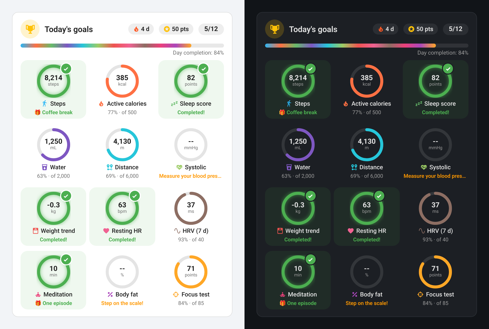
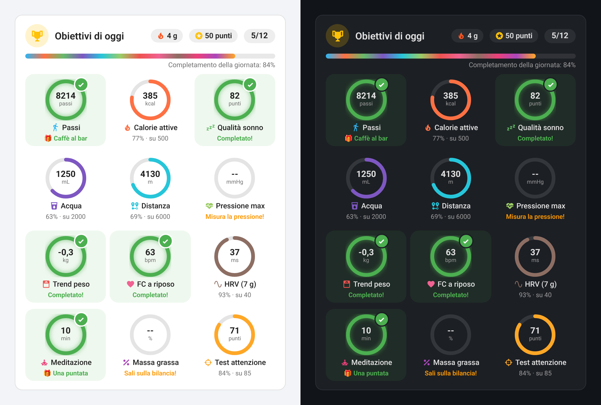

# Daily Goals

[](https://hacs.xyz/docs/faq/custom_repositories)
[](https://github.com/artech-lab/ha-daily-goals/releases)
[](https://github.com/artech-lab/ha-daily-goals/actions/workflows/validate.yml)
[](LICENSE)

**Turn any sensor into a daily goal, and earn rewards for reaching it.**
Steps, sleep score, water, blood pressure, meditation minutes, a weight trend: pick the sensor, set the
target, and Daily Goals tracks the day for you. Every goal achieved earns points and the reward you chose,
with a notification (a different fun picture every day on the mobile app). Achieve all of them and you
get a perfect day; string perfect days together for a streak. No helpers, no templates, no automations,
no YAML.

The interface is available in English and Italian.



## How it works

```text
sensor → value of today → target reached? → points, reward, notification → all reached? → perfect day, streak
```

- **Goals** — each goal follows one entity with a numeric state (`sensor`, `number`, `input_number`,
  `counter`) and has a target. *Reach at least* goals (steps, sleep score) are achieved at or above the
  target; *stay under* goals (blood pressure, resting heart rate, body fat) at or below it.
- **A new day at midnight** — goals start again every day. Each goal decides which values count after
  midnight:
  - *Wait for a new value* (default) — yesterday's value is ignored until the source reports a new one.
    Right for daily counters (the steps of yesterday are not today's) and for measurements you take by
    hand (blood pressure, a scale, a test): until you measure, the card shows an invitation such as
    *Step on the scale!*. A value restored after a restart of Home Assistant is not mistaken for a new
    measurement.
  - *Use the current value* — the value counts whenever it was reported. Right for averages and trends
    that move slowly (7-day heart rate variability).
- **Achieved once a day** — a goal reached today stays achieved until midnight, even if the value moves
  again; it is notified once. Goals already met at midnight by their current value count without a
  notification, and so does a value that comes back after the sensor was unavailable.
- **Complete together** — two or more goals can be linked: they count as achieved only when all of
  them are met at the same time (systolic *and* diastolic blood pressure), with one notification.
- **Rewards** — every goal has points (10 by default) and an optional reward of your choice
  (*"A square of dark chocolate"*), shown in the notification and on the card. A perfect day has its own
  reward. Points add up for the day and in total.
- **Streak** — perfect days in a row; one day that is not perfect starts it again. Milestones (3, 7, 14,
  21, 30, 50, 100… days) and personal bests are celebrated in the notification.
- **Notifications** — to any `notify.*` action (the companion app gets a picture, a tag per goal, a
  channel and an optional page to open), and as persistent notifications in Home Assistant, dismissed at
  midnight.
- **Events** — `daily_goals_goal_achieved` and `daily_goals_perfect_day`, to hand out real-world rewards
  with an automation.
- **Dashboard card** — served and loaded by the integration itself: no dashboard resource to add, and it
  is always the version that matches the integration.

## Requirements

- Home Assistant 2025.8 or newer.
- Optional: the Home Assistant companion app, for push notifications with pictures.

## Installation

[](https://my.home-assistant.io/redirect/hacs_repository/?owner=artech-lab&repository=ha-daily-goals&category=integration)

1. In HACS (*Marketplace* from Home Assistant 2026.11) search for **Daily Goals**. If it is not listed,
   add `https://github.com/artech-lab/ha-daily-goals` as a custom repository with type **Integration**.
2. Download it and restart Home Assistant.

Manual alternative: copy `custom_components/daily_goals` into your `custom_components` folder and restart.

## Setup

[](https://my.home-assistant.io/redirect/config_flow_start/?domain=daily_goals)

1. *Settings → Devices & services → Add integration → Daily Goals*. One entry per person, for example.

   | Field | Default | Description |
   | --- | --- | --- |
   | Name | `Daily goals` | Device name and prefix of the entity IDs. |
   | Notification services | — | `notify.*` actions that receive the achievements, for example `notify.mobile_app_phone`. |
   | Persistent notifications | on | Also show the achievements in Home Assistant (dismissed at midnight). |
   | Pictures in the notifications | on | Companion app only: a different picture every day. |
   | Open on tap | — | Companion app only: the dashboard path opened when the notification is tapped, for example `/lovelace/health`. |
   | Perfect-day reward | — | Your prize when every goal of the day is achieved. |

2. On the integration page press **Add goal**, once per goal.

   | Field | Default | Description |
   | --- | --- | --- |
   | Sensor | — | The entity to follow. |
   | Name | name of the sensor | Shown on the card and in the notifications; also part of the entity IDs. |
   | Target | — | The value to reach, or not to exceed. |
   | Direction | Reach at least | *Reach at least the target* or *Stay at or under the target*. |
   | After midnight | Wait for a new value | See [How it works](#how-it-works). |
   | Complete together with | — | Another goal that must be met at the same time. |
   | **Reward** → Points | 10 | Points earned when the goal is achieved. |
   | **Reward** → Reward | — | A prize you give yourself. |
   | **Reward** → Notify | on | Send a notification for this goal. |
   | **Appearance** → Icon, Color | target, palette | Icon and ring color on the card. |
   | **Appearance** → Unit | unit of the sensor | Unit shown with the value. |
   | **Appearance** → Decimal places | 0 | 0–2. |
   | **Appearance** → Text while waiting | *Waiting for today's value* | Invitation shown until today's value arrives. |

   Change or delete a goal from the ⋮ menu next to it. Some examples:

   | Goal | Sensor | Target | Direction | After midnight |
   | --- | --- | --- | --- | --- |
   | Steps | daily steps of the phone | 7500 | Reach at least | Wait for a new value |
   | Systolic + Diastolic, linked | blood pressure monitor | 135 / 85 | Stay under | Wait for a new value |
   | Weight trend | 7-day weight change | 0 | Stay under | Wait for a new value |
   | HRV | 7-day average | 40 | Reach at least | Use the current value |
   | Meditation | minutes today (an `input_number` reset at midnight) | 10 | Reach at least | Wait for a new value |

3. In a dashboard: *Add card → Daily Goals*. The card finds its entities by itself.

   ```yaml
   type: custom:daily-goals-card
   entity: sensor.daily_goals_achieved
   ```

### Options

*Settings → Devices & services → Daily Goals → Configure*: the notification fields and the perfect-day
reward, as in the setup.

### Card options

| Option | Default | Description |
| --- | --- | --- |
| `entity` | — | **Required.** The *Goals achieved* sensor. |
| `title` | *Today's goals* | Card title. |
| `icon` | `mdi:trophy` | Icon next to the title. |
| `columns` | `3` | Goals per row, 2–4. |
| `show_rewards` | `true` | The reward of an achieved goal in place of *Completed!*, and the perfect-day reward. |
| `show_stats` | `true` | Streak and points of the day in the header. |

Each goal shows its value in a ring that fills towards the target and turns green with a badge when the
goal is achieved. Tap a goal to open its sensor, the counter to open the goals achieved, the chips to open
the streak and the points.



## Entities

Entity IDs are always in English (shown here with the default name and a goal called *Steps*); displayed
names follow the language of Home Assistant.

| Entity | Description |
| --- | --- |
| `sensor.daily_goals_achieved` | Goals achieved today. Attributes: `total`, `perfect_day`, and `goals`, everything the card shows (not recorded in the history). |
| `sensor.daily_goals_completion` | Average progress of the day, % (an achieved goal counts as 100 %). |
| `sensor.daily_goals_streak` | Perfect days in a row. |
| `sensor.daily_goals_best_streak` | Longest streak so far. |
| `sensor.daily_goals_points_today` | Points of the goals achieved today. |
| `sensor.daily_goals_total_points` | Points earned since the start. |
| `binary_sensor.daily_goals_perfect_day` | `on` once every goal has been achieved today. |
| `sensor.daily_goals_steps_progress` | Live progress of the goal towards the target, %; `unknown` while waiting for today's value. Attributes: `value`, `target`, `unit`, `direction`, `daily_reset`, `source`. |
| `binary_sensor.daily_goals_steps_achieved` | `on` once the goal has been achieved today. |

### Events

| Event | Data |
| --- | --- |
| `daily_goals_goal_achieved` | `entry_id`, `name`, `goal_id`, `goal`, `value`, `target`, `unit`, `points`, `reward`, `silent` |
| `daily_goals_perfect_day` | `entry_id`, `name`, `streak`, `best_streak`, `points_today`, `reward`, `silent` |

`silent` is `true` when nothing was notified: the goal was already met at midnight, or its sensor came back
from `unavailable`. Add a condition on it to celebrate only the moments you see happen.

For example, celebrate a perfect day with the living room lights:

```yaml
triggers:
  - trigger: event
    event_type: daily_goals_perfect_day
    event_data:
      silent: false
actions:
  - action: light.turn_on
    target:
      entity_id: light.living_room
    data:
      effect: rainbow
```

### Action `daily_goals.set_statistics`

Sets the streak, the best streak and the total points by hand, for example to carry them over from
another setup. Target any sensor of the set of goals.

```yaml
action: daily_goals.set_statistics
target:
  entity_id: sensor.daily_goals_streak
data:
  streak: 12
  best_streak: 30
  total_points: 2450
```

## Notification pictures

With *Pictures in the notifications* on, the companion app shows a picture from one of these free
services, which need no account: [RandomFox](https://randomfox.ca), [Lorem Picsum](https://picsum.photos),
[Cat as a service](https://cataas.com), [random-d.uk](https://random-d.uk), [place.dog](https://placedog.net),
[RoboHash](https://robohash.org), [LoremFlickr](https://loremflickr.com). The theme changes every day and
differs between goals; the picture is random. If a service is down the notification arrives without a
picture. Only the address of the picture is sent to your phone, which downloads it.

## Troubleshooting

- **The card is not in the card picker** — reload the browser page once after installing or updating.
- **A goal shows *Waiting for today's value* although the sensor has one** — the goal waits for a new
  value after midnight: choose *Use the current value* for sensors that report rarely (averages, trends).
  Two identical measurements in a row are not told apart, because the state of the sensor does not change.
- **Notifications at midnight** — they never come from the midnight reset itself; check that the sensor of
  the goal resets after midnight, not just before.
- **Something else** — attach the diagnostics (*device page → ⋮ → Download diagnostics*) to a
  [new issue](https://github.com/artech-lab/ha-daily-goals/issues).

## Contributing

```bash
python -m venv .venv && . .venv/bin/activate && pip install -r requirements_test.txt
scripts/check.sh
```

The version lives only in `manifest.json`; pushing a new one to `main` publishes the release once the
checks pass. See [`CLAUDE.md`](CLAUDE.md) for the layout of the code.

## License

Copyright © 2026 The ha-daily-goals contributors. Released under the
[GNU General Public License v3.0 or later](LICENSE).
